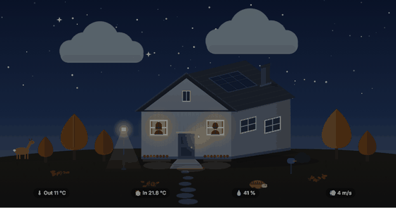
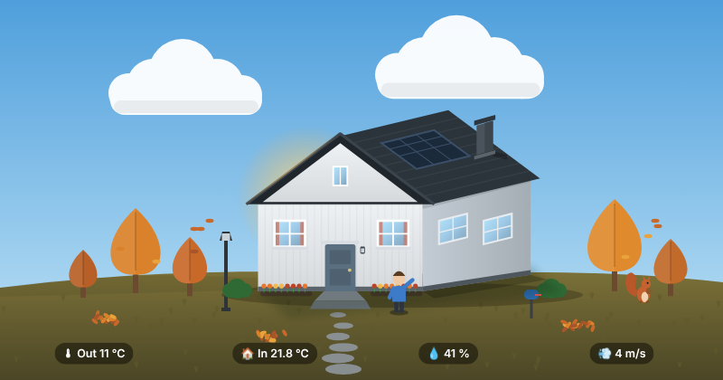
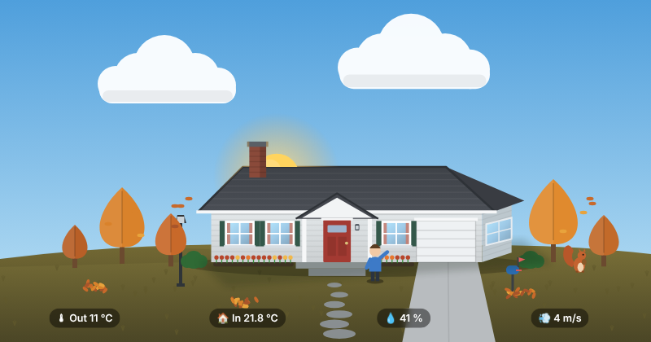
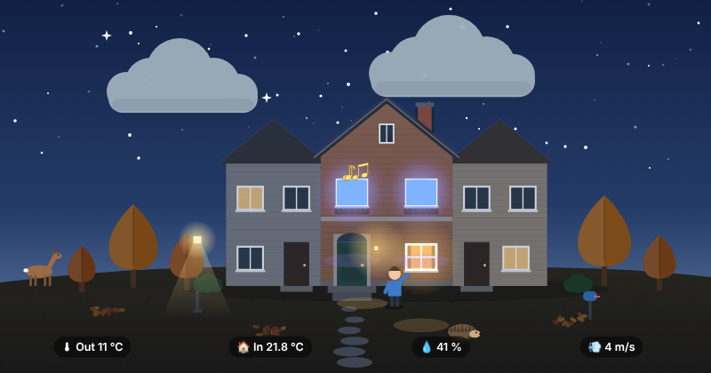
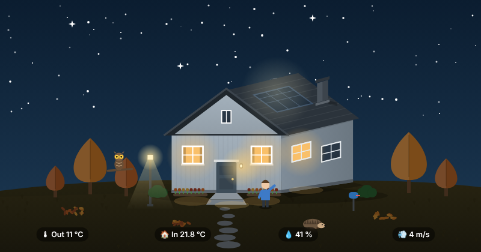
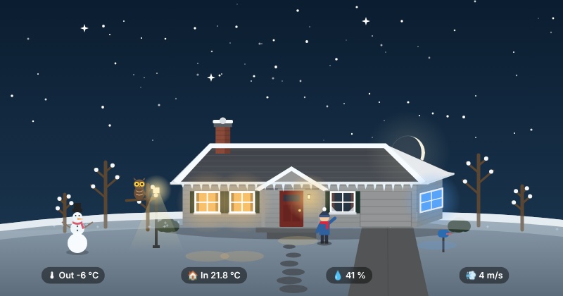
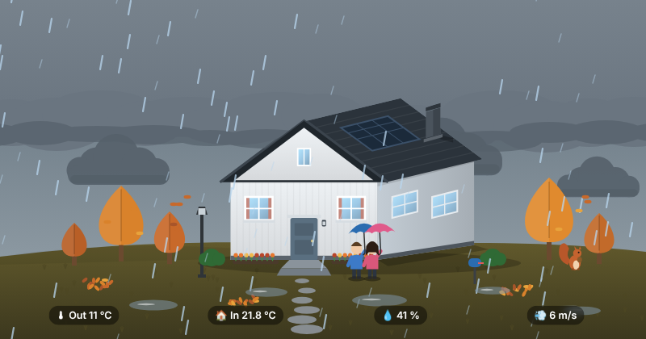
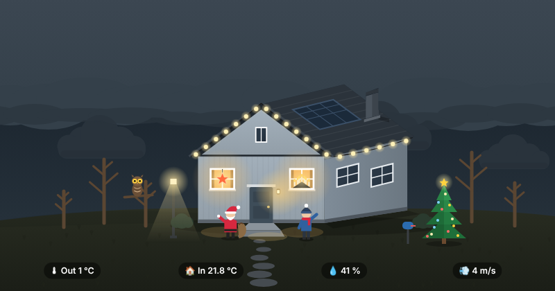
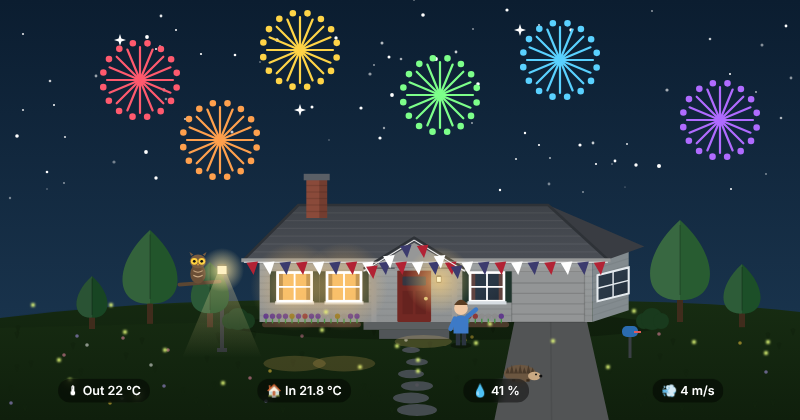
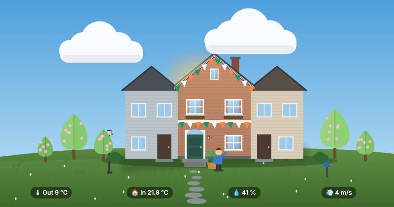

# Living House Card

A Home Assistant card that draws your house as a living picture. The sun and moon follow their real paths, the weather comes from your forecast, the windows glow in the colour of your lamps, and holidays and wildlife show up on their own.



Three houses to choose from: a Swedish villa, an American ranch house and a townhouse.

| | | |
|---|---|---|
|  |  |  |
|  |  |  |
|  |  |  |

Everything is drawn live in the browser as SVG from your Home Assistant state. There are no image files, and the only thing it needs is a weather entity: everything else is optional and switches on when you point it at something you already have. See [What you need](#what-you-need). One JavaScript file of about 135 kB.

**Try it first:** the [demo page](https://thommypersson89-lab.github.io/living-house-card/) has a time machine (fast-forward a day or a year, change the weather) and a configurator that writes the YAML for your house.

> **Provided as is.** This is a hobby project shared in case it is useful to someone. There is no personal support, and issues may not get a response. Use the Discussions tab to help each other. Pull requests that keep the tests green are welcome.

## What it shows

**The sky**
- The sun and moon follow their real paths (from `sun.sun` and your home's location), and the moon shows its real phase
- The light shifts through blue hour, dawn, golden hour, midday and dusk, and turns grey when it's overcast
- Stars on clear nights, northern lights when the aurora forecast says there's a chance, shooting stars during meteor showers

**The weather**
- Clouds follow the forecast's cloud cover and drift with the wind; a full cloud deck when it's overcast
- Four levels of rain, plus snow, sleet, fog, thunder, frost and heat haze
- Trees sway with the actual wind speed; gusts and flying leaves above 10 m/s
- A rainbow and puddles after the rain, and white ground, snow on the roof and a snowman after it has actually snowed

**The house**
- Each window glows in the colour and brightness of the lamp you tie it to; tap it to toggle the lamp
- Music notes rise from the window (or the door, or the roof) where the speakers are playing, but only when they're audible
- A blue TV flicker, soap bubbles while the washing machine runs, and a clothesline when the laundry has been left in the machine
- Chimney smoke grows with your power use and blows with the wind
- The porch light and the street lamp come on after dark, and the mailbox flag goes up when there's something in your calendar

**The people**
- Everyone who is home stands by the door, dressed for the weather: umbrella, beanie and scarf, or sunglasses
- At night they're inside, as silhouettes in the lit windows, and the picture dims
- When nobody is home everything freezes, to save power on a wall tablet

**Holidays and wildlife**
- Sweden: Advent lights, Lucia, a Christmas tree, Santa, semla day, Easter twigs, a Walpurgis bonfire, a midsummer pole, a crayfish party, St. Martin's goose, Halloween pumpkins, New Year fireworks, flag days and more
- United States: holiday lights and a tree from the day after Thanksgiving, Santa on Christmas Eve and Christmas Day, Thanksgiving pie, the Fourth of July with flag, bunting and evening fireworks, flags on Memorial, Flag, Labor and Veterans Day, St. Patrick's Day, Easter eggs, Halloween from mid-October
- Balloons and a flag on birthdays, a cake on name days, popcorn on Friday nights
- Deer at dawn, an owl at night, a hedgehog on mild nights, a hare in winter, a squirrel in autumn, birds, butterflies and fireflies
- One blocky figure in the garden for each player on your Minecraft server

## What you need

**Only `weather` is required.** With nothing else the card already shows the sun, moon, sky, clouds, rain, snow, wind, seasons, holidays, wildlife and the street lamp. Everything below is optional: leave it out and that part is simply not drawn.

| Feature | Needs | |
|---|---|---|
| Sun, moon, stars, light through the day, seasons, holidays, wildlife | Nothing (`sun.sun` and your home location, which every install has) | Out of the box |
| Clouds, rain, snow, fog, thunder, swaying trees | `weather` | Out of the box |
| People by the door, silhouettes at night | `people:` your `person.*` entities | An entity you probably have |
| Glowing windows, tap to toggle | `rooms:` your `light.*` entities | An entity you probably have |
| Music notes, TV flicker | `media_player.*` entities in `rooms:` / `music:` | An entity you probably have |
| Chimney smoke | `power:` a power sensor (W or kW) | An entity you may have |
| Mailbox flag, birthdays | `calendar:` / `birthdays:` a calendar | An entity you may have |
| Soap bubbles, clothesline | `washer:` a washing machine sensor | An entity you may have |
| Indoor temperature in the label | `indoor:` temperature and humidity sensors | An entity you may have |
| Northern lights | `aurora:` an aurora chance sensor (e.g. the Aurora integration) | Optional integration |
| Minecraft players in the garden | `minecraft:` a player count sensor | Optional integration |
| "Rain in 40 min" and a dark rain front | `helpers: rain_soon` | [Ready-made helper](examples/living-house-helpers.yaml) |
| Four rain strengths instead of one | `helpers: rain_now` | [Ready-made helper](examples/living-house-helpers.yaml) |
| Rainbow, puddles and snow that survive a page reload | `helpers: rained_recently`, `snow_on_ground` | [Ready-made helper](examples/living-house-helpers.yaml) (without it the card remembers while the page is open) |

The helper file [`examples/living-house-helpers.yaml`](examples/living-house-helpers.yaml) is a Home Assistant package with all four template sensors, built on your weather entity's hourly forecast. Put it in `config/packages/`, replace `weather.home` with your weather entity, restart, and add the `helpers:` lines from the top of the file to the card.

## Installation

### HACS (custom repository)

HACS installs the file attached to the latest [release](../../releases).


1. In Home Assistant, open **HACS → ⋮ → Custom repositories**.
2. Add `https://github.com/thommypersson89-lab/living-house-card` with the category **Dashboard**.
3. Find **Living House Card** in HACS and download it.
4. Reload your browser.

### Manual

1. Download `dist/living-house-card.js` and copy it to `config/www/` on your Home Assistant server.
2. Go to **Settings → Dashboards → ⋮ → Resources → Add resource**, enter `/local/living-house-card.js?v=0.1.1` and choose **JavaScript module**. Raise `?v=` whenever you replace the file.
3. Reload your browser.

## Quick start

The smallest working card:

```yaml
type: custom:living-house-card
weather: weather.home
```

A typical card:

```yaml
type: custom:living-house-card
weather: weather.home
people:
  - name: Alex
    entity: person.alex
  - name: Sam
    entity: person.sam
rooms:
  - window: front
    name: Downstairs
    light: light.downstairs
  - window: side_left
    name: Living room
    light: light.living_room
    music: [media_player.living_room]
    tv: media_player.living_room_tv
  - window: side_right
    name: Bedroom
    light: light.bedroom
power: sensor.power
calendar: calendar.family
indoor:
  temperature: sensor.living_room_temperature
  humidity: sensor.living_room_humidity
```

The visual editor covers the simple options. People, rooms and colours are set in the YAML editor.

## Options

| Option | Description |
|---|---|
| `weather` (required) | A weather entity. The card uses its state, `cloud_coverage`, `temperature`, `wind_speed` and `wind_bearing`. Fahrenheit, km/h, mph and knots are converted. |
| `house` | The house model: `villa` (default), `ranch` or `townhouse`. See [Houses](#houses). |
| `country` | Which holidays show up: `se` (Sweden, the default), `us` (United States) or `none`. |
| `flag` | The flag on flag days and birthdays: `se` or `us` (defaults to the country's). |
| `language` | Label language: `en` or `sv`. Defaults to your Home Assistant language. |
| `colors` | House colours: `wall`, `side`, `roof`, `door`, `curtains` (hex). |
| `people` | A list of people. See [People](#people). |
| `rooms` | A list of rooms tied to windows. See [Rooms](#rooms). |
| `music.everywhere` | Media players that play in the whole house: notes from every spot that has music. |
| `music.door`, `music.roof` | Speakers by the door, or somewhere you want notes to rise from the roof (a kitchen, say). |
| `power` | A power sensor in W or kW. Chimney smoke above 800, 1500 and 2500 W, and thin smoke when it's below freezing. |
| `minecraft` | A sensor with the number of players online (up to three figures). |
| `birthdays` | A calendar or binary sensor. Balloons, and the flag in daytime, while it is `on`. |
| `calendar` | A calendar. The mailbox flag is up while it is `on`. |
| `washer` | `entity`, `running` (its state while running, default `running`), `laundry_left` (an input boolean for the clothesline), `window` (where the bubbles come out). |
| `indoor` | `temperature` and `humidity` sensors for the labels. |
| `aurora` | A sensor with the aurora chance in %. Northern lights at 10 % or more after dark. |
| `name_days` | A list of `MM-DD` dates: a cake and a flag. |
| `motion.when_home` | Animate only while one of these entities is `home` (default: the first person). |
| `motion.reduce` | An input boolean that freezes everything while it is on. Devices that ask for reduced motion are always frozen. |
| `tap` | `street_lamp`, `mailbox`, `chimney`: an entity to toggle, or a path to open (starting with `/`). |
| `help_path` | Shows a ❓ button that opens this path. |
| `labels`, `large_labels` | Show the labels at the bottom; larger ones for a wall tablet. |
| `night_dim` | `{from: 23, to: 6}` by default; `false` turns it off. |
| `helpers` | Advanced: your own sensors instead of the card's own logic. See [Helpers](#helpers). |

### People

```yaml
people:
  - name: Alex
    entity: person.alex
  - name: Sam
    entity: person.sam
    porch_light: device_tracker.sam_phone   # what turns the porch light on, if not the person
    look:
      jacket: "#2f7d6d"
      hair: "#d9a441"
      long_hair: true
      hat: "#5b3f8a"
      umbrella: "#8a5ad1"
```

Each person gets a built-in look in turn; `look` changes any part of it.

### Rooms

A room ties Home Assistant entities to one of the house's windows.

```yaml
rooms:
  - window: side_left           # which window
    name: Living room           # used in tooltips
    light: light.living_room    # colours the window; tap the window to toggle it
    music: [media_player.living_room]
    tv: media_player.living_room_tv
```

Each house has its own windows; see [Houses](#houses).

### Houses

| House | Windows | Notes |
|---|---|---|
| `villa` | `front` (the two front windows), `side_left`, `side_right` (the side wall), `gable` (under the roof) | A Swedish one-and-a-half-storey house with solar panels. |
| `ranch` | `front` (two windows left of the porch), `front_right`, `side` | One storey, a covered porch, an attached garage and a driveway. |
| `townhouse` | `front` (downstairs), `upstairs` (two windows), `attic` | Two storeys between two neighbouring houses, window boxes and a stoop. People are seen upstairs at night. |

`colors` changes the walls, roof and door of any of them. Music notes can rise from any window, from the `door` or from the `roof`.

### Helpers

The card works everything out by itself, but you can point it at your own sensors instead. [`examples/living-house-helpers.yaml`](examples/living-house-helpers.yaml) has ready-made template sensors for `rain_now`, `rain_soon`, `rained_recently` and `snow_on_ground`.

| Helper | What it is |
|---|---|
| `season` | `spring`, `summer`, `autumn` or `winter` (e.g. the Season integration). Otherwise from the date and your latitude. |
| `moon_phase` | The Moon integration's sensor. Otherwise calculated. |
| `moon_position` | State = elevation in degrees, attribute `azimuth`. Otherwise calculated. |
| `rain_now` | Precipitation this hour in mm. Picks between drizzle, light, moderate and heavy rain. |
| `rain_soon` | Minutes until rain, `soon` or `no`. A dark rain front and a "Rain in … min" label. |
| `rained_recently` | A binary sensor for the rainbow and puddles. Otherwise the card remembers the last two hours while the page is open. |
| `snow_on_ground` | A binary sensor for white ground and snow on the roof. Otherwise the card remembers the last day while the page is open. |
| `aurora_visible` | A binary sensor instead of `aurora`. |
| `holiday` | A sensor whose state is a holiday id. Sweden: `christmas_eve`, `lucia`, `valentines`, `shrove_tuesday`, `waffle_day`, `walpurgis`, `mothers_day`, `national_day`, `crayfish_party`, `cinnamon_bun_day`, `martinmas`, `fathers_day`. US: `christmas_eve`, `christmas_day`, `valentines`, `st_patricks`, `mothers_day`, `memorial_day`, `flag_day`, `fathers_day`, `independence_day`, `labor_day`, `veterans_day`, `thanksgiving`. Both: `name_day`. |

## FAQ

**The windows don't light up.** Each lit window needs a room with a `light`, and the light must be `on`. Coloured lights use their colour when the saturation is above 35 %; white lights use their colour temperature.

**Nothing moves.** The card freezes when nobody in `motion.when_home` (by default the first person) is home, when `motion.reduce` is on, or when the device asks for reduced motion.

**The clouds don't match the sky outside.** The card uses the weather entity's `cloud_coverage`. Integrations without it get a guess from the weather state.

**Can it look like my house?** Pick the closest of the three houses and set its colours. Drawing your own house means adding a house model in `src/model/` (see Development).

**My country isn't there.** Use `country: none` and, if you like, a `holiday` helper sensor that names today's holiday. Pull requests with another country's holidays are welcome.

## Development

```bash
npm ci
npm run build        # dist/living-house-card.js and the demo
npm run serve        # http://localhost:8765/demo/ — the time machine and every test scene
npx playwright install chromium
npm test             # visual tests of 40 scenes, the configurator and the logic
```

- `src/model/` – house models: the drawing of a house plus the anchor points everything else is placed from (windows, door, chimney, eaves, where people stand, where decorations go). A new house is one file there plus a line in `src/model/index.ts`.
- `src/draw/` – the landscape, sky, weather, house overlays and decorations
- `src/derive.ts` – Home Assistant state to a scene
- `src/compose.ts` – a scene to layers, back to front
- `src/living-house-card.ts` – the card: cross-fades, freezing, tap areas and labels

If you change how something looks on purpose, run `npm run test:update`, check the new pictures in `tests/__screenshots__/` and commit them.

Releases: bump `version` in `package.json`, commit, and either push a tag like `v0.2.0` or run the **Release** workflow by hand (it tags `main` with the version). The release workflow attaches `living-house-card.js` to a GitHub release, and the demo page is published to GitHub Pages. `scripts/record-frames.mjs` and `scripts/make-gif.py` make the time-lapse GIF.

## Credits

Built by [@thommypersson89-lab](https://github.com/thommypersson89-lab) together with Claude (Anthropic) as a coding partner. MIT licence.
